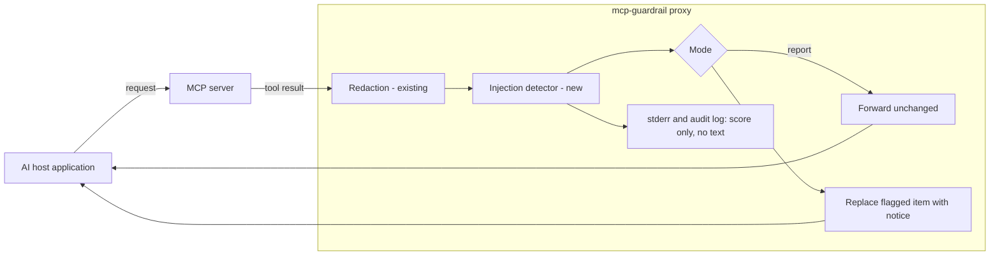

# Design Document: Prompt-Injection Detection for MCP Tool Results

| | |
|---|---|
| **Document ID** | MCPG-DD-001 |
| **Project** | mcp-guardrail (`@nishanthravula/mcp-guardrail`) |
| **Author** | Nishanth Ravula |
| **Status** | Approved |
| **Version** | 1.1 |
| **Created** | 2026-11-11 |
| **Last updated** | 2026-11-11 |
| **Target release** | 0.3.0 |
| **Approver** | Project maintainer |
| **Classification** | Public (open-source project) |

## Revision History

| Version | Date | Author | Summary |
|---|---|---|---|
| 0.1 | 2026-11-11 | N. Ravula | Initial draft of the design |
| 0.2 | 2026-11-11 | N. Ravula | Restructured to a standard design-document template; added numbered requirements, traceability, security and privacy review, alternatives, rollout plan and open questions. No change to the technical design |
| 1.0 | 2026-11-11 | N. Ravula | Approved to build. OQ-1 and OQ-2 closed with the recommended options |
| 1.1 | 2026-11-11 | N. Ravula | Phase 1 built. Added section 19 recording where the implementation differs from this design, and closed OQ-3 |

## Table of Contents

1. [Executive Summary](#1-executive-summary)
2. [Background and Problem Statement](#2-background-and-problem-statement)
3. [Goals and Non-Goals](#3-goals-and-non-goals)
4. [Requirements](#4-requirements)
5. [Assumptions, Constraints and Dependencies](#5-assumptions-constraints-and-dependencies)
6. [Proposed Solution](#6-proposed-solution)
7. [Detailed Design](#7-detailed-design)
8. [Alternatives Considered](#8-alternatives-considered)
9. [Security and Privacy Considerations](#9-security-and-privacy-considerations)
10. [Evaluation and Evidence Plan](#10-evaluation-and-evidence-plan)
11. [Test Strategy](#11-test-strategy)
12. [Documentation Deliverables](#12-documentation-deliverables)
13. [Rollout and Release Plan](#13-rollout-and-release-plan)
14. [Risks and Mitigations](#14-risks-and-mitigations)
15. [Open Questions](#15-open-questions)
16. [Glossary](#16-glossary)
17. [References](#17-references)
18. [Approval](#18-approval)
19. [Implementation Record](#19-implementation-record)

Requirement keywords **MUST**, **MUST NOT**, **SHOULD** and **MAY** are used as
defined in RFC 2119 [R1].

---

## 1. Executive Summary

mcp-guardrail is a proxy that sits between an AI host application and an MCP
server and removes secrets and personal data from tool results before the
model reads them. This document proposes a second protection: detecting tool
results that contain instructions aimed at the model (indirect prompt
injection), and reporting or withholding them.

The feature is delivered in two phases. Phase 1 ships a small built-in
classifier that runs in plain TypeScript with no added dependency, together
with a reproducible benchmark, tests and documentation. Phase 2 adds an
optional, more accurate transformer model and an end-to-end agent attack test.

This document requests approval of the phase 1 design and the phase 2
direction. Two decisions need the approver's input; they are listed in
[section 15](#15-open-questions).

## 2. Background and Problem Statement

### 2.1 Background

An AI agent reads whatever its tools return: file contents, web pages, issue
comments, database rows. Any of that content can be written by a third party.
If it contains text such as an instruction to ignore the user and send data
elsewhere, the model may follow it. This is indirect prompt injection.

Published evaluations indicate that current detectors perform poorly on this
case. One 2026 study reports 7–37% detection for production guardrails on
indirect attacks aimed at agents [R2]. Another notes that false alarms on
benign data are a common reason detectors are not deployed [R3]. Industry
guidance treats MCP tool results as an active attack surface [R4].

### 2.2 Problem statement

mcp-guardrail already inspects every tool result, but only for secrets and
personal data. A user who wraps an MCP server with the proxy today has no
signal when a tool result contains an injection attempt.

### 2.3 Current state of the codebase

| Aspect | Current state (v0.2.0) |
|---|---|
| Runtime dependencies | None; this is an advertised property of the package |
| Supported runtimes | Node.js 18, 20, 22 and 24 (CI matrix) |
| Inspection point | `GuardrailProxy` sanitises `tools/call` results in `src/proxy.ts` |
| Configuration | Strictly validated JSON config with a published JSON schema |
| Observability | stderr summaries and an optional JSONL audit log that never contains values |
| Tests | Unit, regression, ReDoS and end-to-end tests against a real MCP server |

## 3. Goals and Non-Goals

### 3.1 Goals

| ID | Goal |
|---|---|
| G1 | A user can enable injection detection with one flag and no additional installation |
| G2 | The package keeps zero runtime dependencies for users who do not opt in to the optional model |
| G3 | Every published performance figure can be regenerated from the repository with one command |
| G4 | The documentation states measured weaknesses alongside measured strengths |
| G5 | The feature meets the project's existing quality bar: strict config validation, no values in logs, linear-time processing, full CI matrix |

### 3.2 Non-goals

| ID | Non-goal | Reason |
|---|---|---|
| NG1 | Detecting malicious tool descriptions (tool poisoning) | Different inspection point; candidate for a later release |
| NG2 | Scoring requests sent from the host to the server | Requests are already covered by the placeholder and secret guards |
| NG3 | Targeting non-English attacks | Measured if a dataset contains them; not optimised in this release |
| NG4 | Rewriting or "cleaning" flagged text | Silent modification of content is unsafe; the project already avoids rewriting requests for the same reason |
| NG5 | A hosted detection API | Out of scope for a local proxy |
| NG6 | Claiming state-of-the-art accuracy in phase 1 | The phase 1 model is a baseline; see section 10.5 |

## 4. Requirements

### 4.1 Functional requirements

| ID | Requirement | Priority |
|---|---|---|
| FR-1 | The proxy MUST score each text item of a `tools/call` result, including strings in `structuredContent`, when detection is enabled | Must |
| FR-2 | The feature MUST support three modes: `off`, `report` and `block` | Must |
| FR-3 | In `report` mode the result MUST be forwarded unchanged and an event MUST be written to stderr and, if enabled, the audit log | Must |
| FR-4 | In `block` mode the flagged text item MUST be replaced by a fixed notice; other items in the same result and the JSON-RPC envelope MUST NOT be altered | Must |
| FR-5 | `--dry-run` MUST prevent any replacement and MUST log events as `would-injection` | Must |
| FR-6 | The mode MUST be overridable per tool through the existing `tools` config section; a tool with `skip: true` MUST bypass detection | Must |
| FR-7 | The decision threshold MUST be configurable; if omitted, the threshold recorded in the model metadata MUST be used | Must |
| FR-8 | Redaction MUST run before injection scoring, so that the detector operates on redacted text | Must |
| FR-9 | The CLI MUST expose `--detect-injection[=report\|block]` and `--injection-threshold` | Must |
| FR-10 | `mcp-guardrail scan --injection` SHOULD report injection findings in files and stdin, consistent with existing `scan` output | Should |
| FR-11 | The library MUST export an `InjectionDetector` class for programmatic use | Must |
| FR-12 | Phase 2: the proxy MAY load an ONNX model when `onnxruntime-node` is installed and a model path is configured | May |

### 4.2 Non-functional requirements

| ID | Category | Requirement |
|---|---|---|
| NFR-1 | Dependencies | The default detector MUST NOT add any runtime dependency |
| NFR-2 | Performance | Scoring MUST run in time linear in input length; a 1 MB input MUST complete within a fixed budget enforced by a test |
| NFR-3 | Package size | The weights file MUST be under 500 KB |
| NFR-4 | Compatibility | All new code MUST pass on Node.js 18, 20, 22 and 24 |
| NFR-5 | Privacy | Flagged text MUST NOT be written to stderr or the audit log |
| NFR-6 | Fail-safe startup | A missing, corrupted or wrong-version weights file MUST stop startup with a clear error when detection is enabled |
| NFR-7 | Determinism | The same input and model version MUST always produce the same score; the TypeScript and Python implementations MUST agree within 1e-6 |
| NFR-8 | Reproducibility | Training and evaluation MUST use pinned dataset revisions, checksums, pinned dependencies and fixed seeds |
| NFR-9 | Configuration safety | Unknown keys and invalid values MUST be rejected by the existing strict validation, with suggestions for typos |
| NFR-10 | Licensing | Third-party datasets MUST NOT be committed to the repository; each dataset's licence MUST be recorded before use |

## 5. Assumptions, Constraints and Dependencies

### 5.1 Assumptions

| ID | Assumption | Status |
|---|---|---|
| A1 | The feature ships inside the existing package rather than as a separate package | Accepted |
| A2 | Detection is off by default in 0.3.0 | Accepted (see OQ-2) |
| A3 | Users accept a baseline model in 0.3.0 with the stronger model following | Accepted (see OQ-1) |

### 5.2 Constraints

| ID | Constraint | Consequence |
|---|---|---|
| C1 | The package advertises zero runtime dependencies | The default detector is implemented in plain TypeScript |
| C2 | The build environment used for phase 1 has no GPU and cannot reach Hugging Face | Transformer fine-tuning is deferred to phase 2 and runs on the maintainer's machine or a hosted notebook |
| C3 | GitHub and PyPI are reachable from the build environment | GitHub-hosted datasets and a scikit-learn model can be built and tested in phase 1 |

### 5.3 Dependencies

| Dependency | Used for | Shipped to npm users |
|---|---|---|
| Python, scikit-learn, pytest | Training, evaluation and Python tests | No |
| Public attack datasets (section 10.1) | Training and evaluation | No |
| `onnxruntime-node` (phase 2) | Optional transformer inference | Optional peer dependency only |

## 6. Proposed Solution

### 6.1 Overview

Two model tiers behind one interface:

| | Tier 1: built-in linear model | Tier 2: optional transformer |
|---|---|---|
| Phase | 1 | 2 |
| Model | Logistic regression over hashed character and word n-grams | Fine-tuned small encoder exported to ONNX |
| Runtime | Plain TypeScript | `onnxruntime-node` (opt-in) |
| Install cost | None | One extra package and a model file |
| Expected accuracy | Baseline | Higher; to be measured |
| Failure if runtime missing | Not applicable | Startup error with an install hint; no silent fallback |

### 6.2 Architecture



Requests from the host also pass through the proxy; that path is unchanged by
this design and is omitted from the diagram.

### 6.3 Processing sequence for one tool result

1. The existing sanitiser redacts secrets and personal data.
2. Each text item is normalised and split into overlapping windows.
3. Each window is scored; the item's score is the maximum window score.
4. If the score meets the threshold, the configured mode is applied.
5. An event is logged with tool name, JSON path, score and model version.

## 7. Detailed Design

### 7.1 Components shipped in the npm package

| Component | Responsibility | Depends on |
|---|---|---|
| `src/injection/normalize.ts` | Canonicalise text: Unicode NFKC, removal of zero-width characters, lower-casing, whitespace collapsing | None |
| `src/injection/featurize.ts` | Convert normalised text to hashed n-gram counts using a fixed hash function and feature count | normalize |
| `src/injection/linear.ts` | Load the weights file, verify format version and checksum, compute a probability | featurize |
| `src/injection/detector.ts` | Public `InjectionDetector`: windowing, scoring, maximum score and offset of the highest-scoring window | linear |
| `src/proxy.ts` (modified) | Invoke the detector after redaction; apply mode | detector |
| `src/config.ts`, `guardrail.schema.json` (modified) | `injection` section and per-tool override | None |
| `src/audit.ts` (modified) | `injection` and `would-injection` event types | None |
| `src/cli.ts`, `src/scan.ts` (modified) | New flags and `scan --injection` | detector |
| `models/injection-linear-v1.bin`, `.json` | Int8-quantised weights and metadata (feature count, hash seed, threshold table, training commit) | None |

### 7.2 Training and evaluation components (repository only, under `ml/`)

| Component | Responsibility |
|---|---|
| `ml/data/sources.py` | Download each dataset at a pinned revision, verify its checksum, convert to a common schema (`text`, `label`, `source`, `attack_family`) |
| `ml/features.py` | Reference implementation of normalisation and featurisation, identical in behaviour to the TypeScript code |
| `ml/train.py` | Train the linear model with a fixed seed; write weights and metadata |
| `ml/evaluate.py` | Run the protocol in section 10; write `docs/benchmarks/RESULTS.md` and `results.json` |
| `ml/export_golden.py` | Produce golden vectors (text, expected features, expected score) for the parity test |
| `ml/tests/` | pytest suite |

### 7.3 Configuration interface

```jsonc
{
  "injection": {
    "mode": "off",        // "off" | "report" | "block"
    "threshold": 0.9,     // optional; defaults to the model metadata's 1%-false-positive threshold
    "model": "builtin"    // phase 2: path to an ONNX model file
  },
  "tools": {
    "read_text_file": { "injection": "block" },
    "list_directory": { "injection": "off" }
  }
}
```

Precedence, highest first: per-tool setting, CLI flag, config file, default.

### 7.4 Withheld-content notice (block mode)

```
[mcp-guardrail: withheld — this tool result looks like a prompt injection (score 0.97). Run with --dry-run to inspect.]
```

### 7.5 Audit events

```json
{"ts":"…","event":"injection","tool":"read_text_file","id":7,
 "path":"result.content[0].text","score":0.97,"threshold":0.90,
 "model":"injection-linear-v1","action":"block","truncated":false}
```

`would-injection` is emitted under `--dry-run`. Neither event contains the
flagged text.

### 7.6 Error handling

| Condition | Behaviour |
|---|---|
| Weights file missing, wrong format version or checksum mismatch, with detection enabled | Startup fails with an explanatory error (NFR-6) |
| Unknown config key or invalid mode | Rejected by strict validation (NFR-9) |
| Text item larger than 1 MB | First and last 512 KB are scored; event records `truncated: true` |
| Non-text content (images, binary) | Not scored |
| Phase 2 model configured but `onnxruntime-node` absent | Startup fails with an install hint |

## 8. Alternatives Considered

| Option | Description | Decision | Rationale |
|---|---|---|---|
| A | Transformer model only, bundled as a required dependency | Rejected | Breaks the zero-dependency property (C1) and cannot be trained in the phase 1 build environment (C2) |
| B | Keyword and regular-expression rules only | Rejected as the product; retained as a benchmark baseline | Easy to evade by rephrasing; no measurable generalisation |
| C | Call a hosted LLM to judge each tool result | Rejected | Adds latency, cost, a network dependency and sends tool content to a third party |
| D | Separate npm package for detection | Deferred | More maintenance for the same user value; revisit if the optional model grows |
| **E** | **Built-in linear model now, optional transformer later** | **Selected** | Preserves zero dependencies, ships a complete measured feature in phase 1, and provides the baseline the transformer must beat |

## 9. Security and Privacy Considerations

### 9.1 Threat model

| Element | Description |
|---|---|
| Asset | The integrity of the model's instructions and the confidentiality of data the agent can reach |
| Adversary | A third party able to place text in content a tool returns (a file, web page, ticket, database row) |
| In scope | Instructions embedded in tool results |
| Out of scope | A malicious MCP server binary, malicious tool descriptions, direct jailbreaks typed by the user |

### 9.2 Security properties

| Property | How it is met |
|---|---|
| Detector cannot leak secrets | Scoring runs after redaction (FR-8) |
| Logs cannot leak content | Events carry scores and locations only (NFR-5) |
| No denial of service through crafted input | Linear-time scoring with an input cap (NFR-2) |
| No half-configured operation | Fail-safe startup (NFR-6) |
| Model integrity | Weights file checksum verified at load; the existing release workflow publishes with npm provenance |

### 9.3 Known limitations

- The detector is probabilistic. It will miss some attacks and flag some benign
  text. It is a defence-in-depth control, not a guarantee.
- An attacker who knows the model can attempt to craft text that scores below
  the threshold.
- Look-alike characters from other scripts (for example Cyrillic letters) are
  not folded by NFKC normalisation.

### 9.4 Privacy

No tool content leaves the machine. The feature makes no network calls. No
personal data is collected or stored by the detector.

## 10. Evaluation and Evidence Plan

### 10.1 Data

| Category | Candidate sources | Status |
|---|---|---|
| Attacks embedded in tool results | InjecAgent [R5], AgentDojo [R6] | Subject to licence check |
| Benign tool results | Results captured from real MCP servers run over open-source repositories | To be collected |
| Additional attack sets hosted on Hugging Face | For example PromptShield [R3] | Phase 2 |

The final dataset list is fixed in the implementation plan after licence
checks (NFR-10).

### 10.2 Protocol

Leave-one-dataset-out: train on all sources except one, test on the held-out
source, and repeat for each source. This measures performance on attacks
unlike the training data, which a random split would hide [R2].

### 10.3 Metrics

| Metric | Purpose |
|---|---|
| Detection rate at 1% false-positive rate | Primary operating point |
| Detection rate at 0.1% false-positive rate | Strict operating point for block mode |
| AUROC | Threshold-independent comparison |
| Latency per kilobyte on one CPU core | Runtime cost |

### 10.4 Baselines

| Phase | Systems compared |
|---|---|
| 1 | Keyword and regex rule list; built-in linear model |
| 2 | Adds the fine-tuned transformer and Meta Prompt Guard 2 |

### 10.5 Expected outcome

The linear model is expected to be clearly weaker than published transformer
detectors on held-out attack sources. Results will be reported as measured.
Phase 1 makes no state-of-the-art claim (NG6).

### 10.6 Integrity of published figures

All figures are produced by `python -m ml.evaluate`. A CI check fails if the
README results table differs from the generated `results.json`. The results
file records dataset revisions, seeds and the git commit.

## 11. Test Strategy

### 11.1 Test levels

| Level | Scope |
|---|---|
| Unit (TypeScript) | Normalisation cases; hash stability across Node versions; weights loader rejects bad version and checksum; windowing finds an injection in the middle of long benign text |
| Parity | TypeScript score equals Python score within 1e-6 on at least 500 golden texts, including non-ASCII |
| Regression | Fixed known attacks score above threshold; fixed tricky benign texts (security documentation, a README discussing prompt injection) score below |
| Performance | 1 MB input completes in linear time within budget |
| Configuration | New keys validated; typos receive suggestions |
| End-to-end | A fake MCP server returns one clean and one injected result through the real proxy, exercised in report, block and dry-run modes, with redaction active in the same message |
| Python | Dataset converters; deterministic training; metric functions against hand-computed cases |

### 11.2 Requirements traceability

| Requirement | Verified by |
|---|---|
| FR-1, FR-8 | End-to-end tests |
| FR-2 – FR-5 | End-to-end tests (report, block, dry-run) |
| FR-6, FR-7, FR-9, NFR-9 | Configuration and CLI tests |
| FR-10 | Scan tests |
| FR-11 | Unit tests on the public API |
| FR-12 | Phase 2 test plan |
| NFR-1 | CI check that `package.json` declares no runtime dependencies |
| NFR-2 | Performance test |
| NFR-3 | CI check on weights file size |
| NFR-4 | CI matrix |
| NFR-5 | End-to-end assertion that logs contain no result text |
| NFR-6 | Unit tests on the weights loader |
| NFR-7 | Parity test |
| NFR-8 | Python determinism test; CI regeneration of golden vectors |
| NFR-10 | Review checklist item; `.gitignore` rule for downloaded data |

### 11.3 Continuous integration

The existing Node.js matrix is unchanged. A Python job is added that runs the
pytest suite, regenerates the golden vectors and verifies they match the
committed ones.

## 12. Documentation Deliverables

| Deliverable | Content |
|---|---|
| README section | One-flag quick start and the results table |
| `docs/injection-detection.md` | How it works, configuration, choosing a threshold, limitations |
| `MODEL_CARD.md` | Training data and licences, intended use, metrics, known failure cases, how to retrain |
| `docs/benchmarks/RESULTS.md` | Generated benchmark report |
| `CHANGELOG.md` | 0.3.0 entry |
| `guardrail.schema.json` | Schema for the new config keys |

## 13. Rollout and Release Plan

### 13.1 Milestones

| Milestone | Deliverable | Exit criteria |
|---|---|---|
| M0 | Design approved | Sign-off in section 18 |
| M1 | Implementation plan | Plan reviewed and approved |
| M2 | Data pipeline and trained linear model | Deterministic training; licences recorded |
| M3 | TypeScript detector and parity | Parity test passes on all Node versions |
| M4 | Proxy, CLI and config integration | End-to-end tests pass |
| M5 | Benchmark and documentation | Results generated; README table check passes |
| M6 | Release 0.3.0 | CI green; changelog complete; published through the existing release workflow |
| M7 | Phase 2 | Transformer, external baseline and agent attack test added to the benchmark |

### 13.2 Release approach

- Detection is opt-in in 0.3.0 (subject to OQ-2). Existing users see no change
  in behaviour after upgrading.
- The change is additive; no existing option changes meaning. Under semantic
  versioning this is a minor release.
- Rollback: disable with `mode: "off"` or pin the previous version.

### 13.3 Success criteria

| Criterion | Measure |
|---|---|
| Correctness | All tests in section 11 pass in CI |
| Evidence | Benchmark report published with reproducible figures |
| Compatibility | No change in behaviour for users who do not enable the feature, verified by the existing test suite passing unmodified |

## 14. Risks and Mitigations

| ID | Risk | Likelihood | Impact | Mitigation |
|---|---|---|---|---|
| R-1 | Linear model performs poorly on held-out attacks | High | Medium | Report as measured; keep default mode off; deliver the transformer in phase 2 |
| R-2 | False positives on documents that discuss prompt injection | Medium | High | Regression set of such texts; threshold set at a fixed false-positive rate |
| R-3 | Python and TypeScript featurisers diverge | Medium | High | Parity test on golden vectors in CI |
| R-4 | A dataset licence forbids the intended use | Medium | Medium | Download from upstream only; exclude any set with an unclear licence |
| R-5 | Benign training data does not resemble real tool traffic | Medium | Medium | Capture benign results from real MCP servers |
| R-6 | Look-alike characters evade normalisation | Medium | Low | Documented limitation; measured in the regression set |
| R-7 | Phase 2 depends on resources outside the build environment | High | Medium | Training script delivered in the repository; maintainer runs it locally or in a hosted notebook |

## 15. Open Questions

| ID | Question | Recommendation | Owner | Status |
|---|---|---|---|---|
| OQ-1 | Ship the linear model in 0.3.0 before the transformer is available, or wait and ship only the transformer? | Ship the linear model first | Maintainer | Closed: recommendation adopted when the maintainer approved the build on 2026-11-11 |
| OQ-2 | Default mode in 0.3.0: `off`, or `report`? | `off` | Maintainer | Closed: recommendation adopted when the maintainer approved the build on 2026-11-11 |
| OQ-3 | Final list of training and evaluation datasets | Decide in the implementation plan after licence checks | Author | Closed: AgentDojo and InjecAgent (both MIT), local text files and synthetic training rows; see `ml/data/README.md` |

## 16. Glossary

| Term | Meaning |
|---|---|
| MCP | Model Context Protocol, a standard for connecting AI applications to tools and data |
| Tool result | The content an MCP server returns after a tool call |
| Indirect prompt injection | Instructions hidden in content the model reads, as opposed to typed by the user |
| False-positive rate | Share of benign items wrongly flagged |
| Detection rate | Share of attacks correctly flagged |
| AUROC | Area under the ROC curve; a threshold-independent measure of ranking quality |
| ONNX | An open format for running trained models outside the training framework |
| Leave-one-dataset-out | Evaluation in which an entire data source is withheld from training and used only for testing |
| NFKC | A Unicode normalisation form that folds compatibility variants of characters |

## 17. References

| ID | Reference |
|---|---|
| R1 | S. Bradner, "Key words for use in RFCs to Indicate Requirement Levels", RFC 2119. https://www.rfc-editor.org/rfc/rfc2119 |
| R2 | M. Fomin, "When Benchmarks Lie: Evaluating Malicious Prompt Classifiers Under True Distribution Shift", arXiv:2602.14161, 2026. https://arxiv.org/abs/2602.14161 |
| R3 | "PromptShield: Deployable Detection for Prompt Injection Attacks", arXiv:2501.15145. https://arxiv.org/abs/2501.15145 |
| R4 | Cloud Security Alliance, "MCP Security: Tool Poisoning and the Confused Deputy Problem", 2026. https://labs.cloudsecurityalliance.org/research-rb/csa-whitepaper-mcp-security-agentic-attack-surface-20260516/ |
| R5 | InjecAgent benchmark repository. https://github.com/uiuc-kang-lab/InjecAgent |
| R6 | AgentDojo benchmark repository. https://github.com/ethz-spylab/agentdojo |

## 18. Approval

| Role | Name | Decision | Date |
|---|---|---|---|
| Author | Nishanth Ravula | Submitted for review | 2026-11-11 |
| Approver (maintainer) | Nishanth Ravula | Approved to build | 2026-11-11 |

## 19. Implementation Record

Differences between this design and what phase 1 shipped, with the reason for each.

| Area | Design | As built | Reason |
|---|---|---|---|
| Default threshold (FR-7) | The model's 1%-false-positive threshold | The larger of that threshold and 0.5, stored as `thresholds.default` | The measured 1% threshold (0.28) was too eager for text unlike the benign training data |
| Training data (10.1) | AgentDojo, InjecAgent, benign results from real MCP servers | Those two datasets, text files read from `node_modules` as a filesystem server would return them, and synthetic rows written for the project (training only) | A first model trained on the two datasets alone scored a textbook attack at 0.40; the synthetic rows add generic phrasing and instruction-like benign text |
| Locating injections in AgentDojo logs | Not specified | Alphanumeric-only matching with prefix and fragment rules | Tool results are often YAML, which re-wraps and re-quotes the injected text |
| Extra benchmark splits (10.2) | Leave-one-dataset-out | Also one attack family and one AgentDojo suite held out | More detail on where the model is weak; the family rows are labelled optimistic |
| Scored content (FR-1) | Text items and `structuredContent` strings | Also the text of embedded resources | A file returned as an embedded resource is as untrusted as one returned as text |
| Golden vectors (11.1) | Texts including dataset samples | 520 generated texts from an own-written vocabulary | NFR-10 forbids committing dataset content |
| Latency metric (10.3) | Reported in the benchmark | Measured in the TypeScript runtime and stated in the guide; linear scaling enforced by a test | The Python reference is not the shipped runtime |
| Known false positive | Not anticipated | One benign security-policy paragraph and correspondence telling a person to ignore an earlier message are flagged | Documented and pinned by tests rather than tuned away on hand-written examples |

Measured results are in `docs/benchmarks/RESULTS.md`. Phase 2 (section 6.1, tier 2) is not started.
